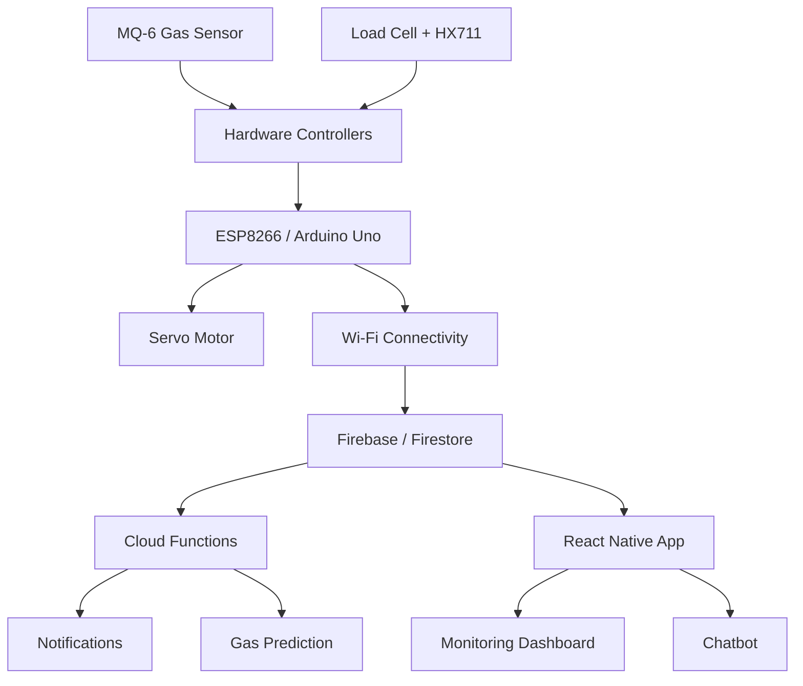

#  LPG-Parent
### Smart LPG Monitoring & Safety System

<p align="center">
  <strong>Monitor Smarter. Detect Faster. Stay Safer.</strong>
</p>

<p align="center">
  
  
  
  
  
</p>

---

## 🚀 Overview

**LPG-Parent** is an IoT-powered smart LPG monitoring and safety system designed to make domestic gas usage safer, smarter, and more convenient.

The system combines hardware sensors, intelligent monitoring, cloud connectivity, and a dedicated mobile application to provide real-time insights into LPG cylinder status.

From tracking remaining gas levels to detecting dangerous gas leakage, LPG-Parent helps users monitor their LPG cylinders remotely and receive timely safety alerts.

Our goal is simple: **Bring intelligence, automation, and safety to everyday LPG usage.**

## ✨ Key Features

| Feature | Description |
|---|---|
| ⚖️ Real-Time Weight Monitoring | Tracks cylinder weight using a Load Cell and HX711 module. |
| 🔥 Gas Leakage Detection | Uses an MQ-6 sensor to detect LPG leakage. |
| 🛑 Automatic Safety Mechanism | Uses a servo motor for automated regulator control. |
| 📱 Mobile Application | React Native application for remote monitoring. |
| ☁️ Cloud Synchronization | Firebase integration for storing and accessing device data. |
| 🔔 Instant Notifications | Sends alerts when gas leakage is detected. |
| 🤖 AI Chatbot | Dialogflow-powered chatbot for interacting with LPG monitoring data. |
| 📊 Gas Consumption Prediction | Uses historical weight data and linear regression to estimate remaining gas duration. |

## 🏗️ System Architecture

LPG-Parent consists of three major layers:

1. **Hardware Layer:** Sensors and controllers collect physical measurements and respond to safety conditions.
2. **Cloud Layer:** Firebase handles data storage, backend functions, and notifications.
3. **Application Layer:** React Native provides users with monitoring, insights, and interaction features.



## 🔩 Hardware Components

| Component | Purpose |
|---|---|
| ESP8266 | Wi-Fi connectivity and IoT communication |
| Arduino Uno | Hardware control and sensor interfacing |
| HX711 | Load cell amplifier and weight measurement |
| Load Cell | Measures LPG cylinder weight |
| MQ-6 | Detects LPG gas leakage |
| Servo Motor | Controls the automatic safety mechanism |

## 💻 Software & Technology Stack

### Mobile Application
- React Native
- JavaScript / TypeScript

### Embedded Systems
- C++
- Arduino IDE
- ESP8266
- Arduino Uno

### Backend & Cloud
- Google Firebase
- Cloud Firestore
- Firebase Cloud Functions
- Firebase Cloud Messaging (FCM)

### Intelligent Features
- Dialogflow Chatbot
- Simple Statistics
- Linear Regression for consumption prediction

## 📱 Application Features

The mobile application acts as the central interface for LPG monitoring.

- Live cylinder weight monitoring.
- Gas leakage status and safety alerts.
- User authentication and device management.
- Cylinder tare-weight configuration.
- Historical weight tracking and visualization.
- Gas consumption prediction.
- Chatbot interaction for LPG-related information.
- Push notifications for important events.

<p align="center">
  <em>Application screenshots coming soon.</em>
</p>

<!-- Add screenshots in the assets/screenshots directory -->

## 🧠 Intelligent Gas Consumption Prediction

LPG-Parent uses historical cylinder weight readings to estimate gas consumption patterns.

The system:

1. Collects historical weight measurements.
2. Identifies the latest refill period.
3. Processes valid historical readings.
4. Applies linear regression to estimate the consumption trend.
5. Calculates an estimated number of days remaining.

The actual LPG weight is calculated using:

\[
\text{Gas Remaining} = \text{Total Cylinder Weight} - \text{Tare Weight}
\]

The prediction is an estimate based on available historical measurements, not a guaranteed refill date.

## 🔔 Safety & Notification System

Safety is a core part of LPG-Parent.

When the system detects a gas leakage condition:

- The hardware safety mechanism is activated.
- Device status is synchronized with the cloud.
- Firebase Cloud Functions process the alert.
- A push notification is sent to the registered user.

**Note:** The automatic shutoff mechanism must be physically tested and validated before relying on it for real-world gas safety.

## 🛠️ Installation & Setup

### 1. Clone the Repository

```bash
git clone https://github.com/shrajal01/LPG-Parent.git
cd LPG-Parent
```

### 2. Install Mobile App Dependencies

```bash
npm install
```

### 3. Firebase Configuration

- Create or configure a Firebase project.
- Configure Firebase Authentication and Cloud Firestore.
- Add the required Android Firebase configuration.
- Configure Firebase Cloud Functions.
- Set up Firebase Cloud Messaging.
- Configure Dialogflow credentials securely.

**Important:** Never upload service-account private keys, passwords, or other secrets to GitHub.

### 4. Run the Mobile Application

For Android:

```bash
npx react-native run-android
```

### 5. Hardware Setup

- Connect the load cell to the HX711 module.
- Interface the MQ-6 gas sensor with the hardware controller.
- Connect the servo motor to the appropriate controller.
- Configure the ESP8266 Wi-Fi connection.
- Upload the Arduino C++ firmware using Arduino IDE.
- Verify sensor readings and cloud communication.

*Refer to the hardware implementation and firmware configuration for the exact pin mapping and wiring.*

## 📂 Project Structure

```text
LPG-Parent/
│
├── android/
├── ios/
├── screens/
│   ├── AddDeviceScreen.tsx
│   ├── BookingScreen.tsx
│   ├── ChatScreen.tsx
│   ├── HomeScreen.tsx
│   ├── InfoScreen.tsx
│   ├── LoginScreen.tsx
│   ├── SettingsScreen.tsx
│   └── WeightGraphScreen.tsx
│
├── functions/
│   └── index.js
│
├── __tests__/
├── App.tsx
├── app.json
├── package.json
└── README.md
```

## 🔮 Future Scope

- More accurate gas consumption forecasting.
- Improved sensor calibration and anomaly detection.
- Enhanced hardware reliability and safety validation.
- Refill reminders and usage analytics.
- Support for multiple LPG cylinders and devices.
- Improved chatbot capabilities and multilingual support.

## 👥 Team notlikeus

**Built with passion by Team notlikeus for HackCBS 9.0.**

We believe technology can make everyday life safer, smarter, and more connected.

---

<p align="center">
  <strong>🔥 LPG-Parent — Smart Monitoring. Safer Living.</strong>
</p>
